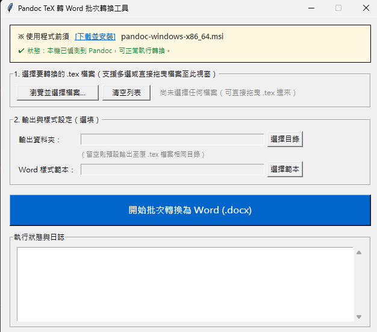

# Pandoc TeX 轉 Word 批次轉換工具 (GUI)

[-0066CC?style=for-the-badge&logo=windows)](https://github.com/blues32767/pandoc_LaTeX-toDocx_gui/releases/download/v1/pandoc_LaTeX.toDocx_gui.-20261127.exe)

> **👉 [點此直接下載最新 Windows 執行檔 (`pandoc_LaTeX.toDocx_gui.-20261127.exe`)](https://github.com/blues32767/pandoc_LaTeX-toDocx_gui/releases/download/v1/pandoc_LaTeX.toDocx_gui.-20261127.exe)**

一個專為 **Pandoc** 打造的輕量級 Windows 圖形介面（GUI）批次轉換工具。免背誦終端機指令，透過直覺的視窗操作與滑鼠拖曳，即可一鍵將 LaTeX（`.tex`）文件轉換為 Word（`.docx`）檔案。

---

## 🖼️ 程式畫面預覽



---

## ✨ 功能特色

* **免指令全圖形介面**：無需開啟 CMD 或 PowerShell 輸入繁瑣參數，點擊按鈕即可完成設定與轉檔。
* **支援滑鼠直接拖曳**：支援將單個或多個 `.tex` 檔案從資料夾直接拖曳進視窗載入（自動過濾非 `.tex` 檔案）。
* **批次多檔轉換**：可一次選取多個檔案依序轉檔，並在背景執行緒運作，轉檔過程視窗不卡頓。
* **環境自動偵測**：啟動時自動檢查本機是否已安裝 Pandoc，並提供官方下載快速連結。
* **自訂輸出與樣式**：支援指定輸出資料夾（留空則預設輸出於原檔案相同目錄）以及套用自訂 Word 參考樣式範本（`--reference-doc`）。

---

## ⚙️ 使用前準備（環境需求）

本工具為 Pandoc 的圖形化操作介面，執行轉換前請先確認電腦已安裝 **Pandoc** 轉檔引擎：

1. 前往 Pandoc 官方發布頁面下載 Windows 安裝檔：
   👉 **[https://github.com/jgm/pandoc/releases](https://github.com/jgm/pandoc/releases)**（下載 `pandoc-x.xx-windows-x86_64.msi`）
2. 雙擊安裝檔並依預設步驟完成安裝（系統會自動設定環境變數）。

---

## 🚀 使用方式

### 方法一：直接執行 Windows 執行檔（推薦）
1. 下載 **[`pandoc_LaTeX.toDocx_gui.-20261127.exe`](https://github.com/blues32767/pandoc_LaTeX-toDocx_gui/releases/download/v1/pandoc_LaTeX.toDocx_gui.-20261127.exe)**（無需安裝 Python 環境）。
2. 雙擊開啟程式，確認上方狀態列顯示「✔ 本機已偵測到 Pandoc」。
3. 點擊「瀏覽並選擇檔案...」或**直接將 `.tex` 檔案拖曳進視窗**。
4. （選填）設定自訂輸出資料夾或 Word 樣式範本（`.docx`）。
5. 點擊 **「開始批次轉換為 Word (.docx)」** 即可完成。

### 方法二：從 Python 原始碼執行
若需自行修改介面或功能，可安裝依賴套件後直接執行 `.py` 原始碼：

```bash
# 安裝拖曳功能支援套件
pip install tkinterdnd2

# 啟動程式
python pandoc_tex2docx_gui.py
